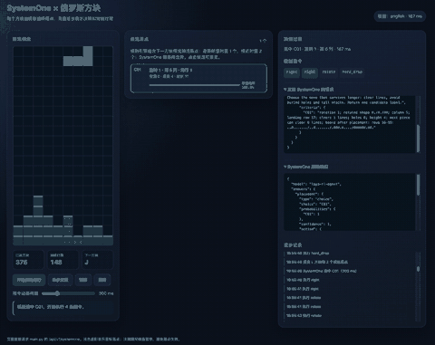

# jev-alternative · Local Laya decision API

English | [简体中文](README.zh-CN.md)

Run Laya on your own machine through an authenticated HTTP API for **classification, scoring, and decision tasks**.

- **Support routing:** classify a ticket and estimate whether a refund is requested.
- **Agent routing:** select a tool from explicit candidates.
- **Game decisions:** inspect candidate moves and model choices in Tetris and Snake.

Built on the upstream [Laya models](https://huggingface.co/convaiinnovations/laya). This project adds local deployment, authentication, input validation, and integration examples; model training and capabilities belong to upstream. It does not call Jev or consume Jev tokens. Compatibility with Jev clients has not been verified.



**See it before installing:** download the repository and open [frontend/replay/index.html](frontend/replay/index.html) in a browser. This lightweight replay contains recorded model responses; it makes no API calls and performs no live inference. Full recordings: [Tetris](tetris.gif) · [Snake](snake.gif).

## Quick start: one model

Requires **Python 3.12**. The first installation needs internet access, space for PyTorch and model weights, and available RAM. Download and startup times depend on your machine and network. Inference runs locally after preparation.

```bash
# Skip bundled Git LFS weights; setup downloads just the selected model.
GIT_LFS_SKIP_SMUDGE=1 git clone https://github.com/tangwut/jev-alternative.git
cd jev-alternative
python3.12 -m venv .venv
source .venv/bin/activate
python -m pip install -r requirements.txt
python scripts/setup_local.py
python main.py
```

The setup tool downloads the pinned **multilingual** checkpoint, verifies its SHA-256, and creates a private `.env` with a random API key. It refuses to overwrite existing configuration. If you already have complete weights, use `python scripts/setup_local.py --model-root models` instead. Git LFS pointers are not weights.

For Windows commands, other models, device settings, Docker, and troubleshooting, see [operations](docs/operations.md). The games use the **English** model; choose `--model english` during setup if you want live game inference.

Wait for `Models ready`, then activate the same virtual environment in another terminal:

```bash
python example_client.py --scenario support --model multilingual
python example_client.py --scenario agent --model multilingual
```

`GET http://127.0.0.1:8000/health` returns `{"status":"ready","models":["multilingual"]}` once the service is ready. Open `http://127.0.0.1:8000/docs`, select **Authorize**, and enter your `.env` API key to explore the inference endpoint.

## What a decision looks like

Send a state and questions with explicit outcomes:

```json
{
  "state": {"message": "我被重复扣款了，请退款。"},
  "model": "multilingual",
  "questions": {
    "department": {
      "type": "choice",
      "instructions": "Which department should handle this request?",
      "criteria": {
        "billing": "payments, duplicate charges and refunds",
        "technical": "software bugs and outages",
        "general": "other inquiries"
      }
    }
  }
}
```

The API preserves Laya's `answers`, `usage`, and `routing` output. See [business examples and recorded responses](docs/examples.md) for complete requests and actual outputs.

| Question type | Use | Interpretation |
| --- | --- | --- |
| `choice` | Select a department or tool | Choice among supplied candidates |
| `score` | Evaluate urgency on ordered levels | Expected index of the supplied levels |
| `noul` | Evaluate “refund requested?” | Probability of the proposition, not a boolean |

Choice/score confidence is an entropy score, not a universal probability of correctness. The agent example recommends a tool; it does not execute tools or issue refunds. Game demos first filter candidates with local rules, then ask the model to choose.

## Scope and limits

- One process and one active inference request; concurrent inference returns **503** with `Retry-After: 1`.
- Requests are limited to **64 KiB**, 1–20 questions, and up to 20 choice/score criteria. Model context limits can still truncate long inputs.
- Explicitly select a preloaded model. Unconfigured models return **422** and are never loaded on demand.
- CPU is the default. CUDA/MPS require compatible hardware and dependencies; check logs for fallback.
- No published cross-platform latency or accuracy benchmark yet. Unit tests do not establish prediction quality.
- Local server defaults to `127.0.0.1`. See [deployment guidance](docs/operations.md#deployment) before exposing it beyond your machine.

## Contribute

API tests do **not** require model downloads:

```bash
python -m pip install -r requirements-ci.txt
python -m pytest -q
node --test frontend/tetris/tests/core.test.mjs frontend/snake/tests/core.test.mjs frontend/replay/tests/replay.test.mjs
```

Read [CONTRIBUTING.md](CONTRIBUTING.md), report reproducible issues, or propose a small improvement with validation. [Roadmap](docs/roadmap.md) lists concrete areas where feedback and contributions help. [Security reports](SECURITY.md) should never include your key or `.env`.

If this project helps you, a star makes it easier to find again. Subscribe to releases if you want update notifications; fork when you want to change or contribute code.

## License and attribution

Project code: [MIT](LICENSE). Bundled/downloaded Laya models: [Apache-2.0](models/LICENSE), from Convai Innovations. [MODEL_PROVENANCE.md](MODEL_PROVENANCE.md) records the pinned revision and weight hashes. Neither this repository nor its license replaces the upstream model license.
